# cortex 🧠⚡🛡️

> **The Universal Prefrontal Cortex, Associative Memory, & Safety Harness for AI Coding Agents & Local LLMs.**  
> *Zero external dependencies • Native Model Context Protocol (MCP) Server • Bare-Metal Mojo 1.1.0 SIMD Kernels + Python SDK*

<p align="center">
  
</p>

---

> [!NOTE]
> **In Plain English:** Every developer using AI coding agents (Claude Code, Cursor, Windsurf, Cline, Goose) or local LLMs (Ollama, LM Studio, vLLM, RWKV-7) hits the same wall:
> 1. **Token & VRAM Burn:** Agents read entire 2,000-line files or ingest 5,000 lines of noisy test output, burning API credits and blowing out 16GB–32GB local VRAM.
> 2. **Cross-Session Amnesia & Stale Memory:** Agents forget project conventions between sessions, or get confused when variables/architectures change.
> 3. **Infinite Loops & Broken Workspaces:** Agents repeat failing commands 5 times in a row or corrupt working code with no way to undo just the agent's edits without wrecking `.git` history.
> 4. **Local LLM Tool Failures:** 7B–32B local models choke when given 50+ MCP tools or emit broken JSON tool calls.
>
> **`cortex`** solves all four in a single zero-dependency package. Drop it into any MCP client or local agent loop in 10 seconds.

---

## ⚡ What `cortex` Gives Your Agent

| Subsystem | Powered By (arXiv Breakthrough) | What It Does | Empirical Speed |
| :--- | :--- | :--- | :--- |
| **1. Hybrid Neural Memory** | **Titans** ([2501.00663](https://arxiv.org/abs/2501.00663)) + **Gated DeltaNet-2** ([2605.22791](https://arxiv.org/abs/2605.22791)) | Surprise-driven test-time memorization with **1.0000 exact key overwrite** and surgical key deletion ($\alpha_{\text{erase}}, \beta_{\text{write}}$) | **`835 µs`** recall |
| **2. Context Sieve** | **SnapKV** ([2404.14469](https://arxiv.org/abs/2404.14469)) Observation Clustering | Compacts 2,500-line build/test logs by **98.8%**, keeping 100% of tracebacks, `file:line` pointers, and surrounding clusters | **`4.25 ms`** (26k tokens saved) |
| **3. Polyglot Symdex** | Zero-DB AST/Regex Call-Graph Indexer | Finds functions, classes, structs & traits across Python, Mojo, Rust, TS/JS, Go, C++ without reading whole files | **`227 µs`** lookup |
| **4. CoW Time Machine** | Content-Addressable SHA-256 Blob Store | Takes instant snapshots before risky edits and atomically rewinds broken workspaces without touching `.git` | **`< 5 ms`** rollback |
| **5. Execution Shield** | Pre-Simulation Trajectory Forecaster | Blocks destructive commands (`rm -rf`, `DROP DATABASE`, `--force`), halts 3-turn agent loops, and repairs broken JSON tool calls | **`7.0 ms`** |
| **6. Ternary Tool Router** | **BitNet b1.58** ([2402.17764](https://arxiv.org/abs/2402.17764)) Multiplier-Free GEMV | Prunes 100+ MCP tools down to the top-K relevant schemas using 2-bit packed ternary addition/subtraction | **`887 µs`** (75–95% pruned) |
| **7. Knapsack Context Packer & 1-Bit Search** | **ROMS** Native Mojo 1.1.0 Engine | Bounded 0/1 dynamic-programming knapsack that **reserves failed-attempt warnings first** + 1-bit `BinaryVector` (`32x` compression, bitwise XOR + popcount) | **`0.171 ms`** (**`25.61x`** faster in Mojo) |
| **8. Speculative Prompt Lookup & Prefix Trie** | **mojond** Native Mojo 1.1.0 Runtime | Parameter-free greedy n-gram speculative token drafting (`prompt_lookup`), `PrefixIndex` cache slot trie, and `TokenBudget` admission controller | **`0.029 ms`** (**`3.22x`** faster in Mojo) |

---

## 🏗️ Architecture

```text
   ┌──────────────────────────────────────────────────────────────────────────────┐
   │      Claude Code  •  Cursor  •  Windsurf  •  Ollama  •  RWKV-7 Goose         │
   └──────────────────────────────────────┬───────────────────────────────────────┘
                                          │ JSON-RPC 2.0 (MCP stdio) / CLI / SDK
                                          ▼
   ┌──────────────────────────────────────────────────────────────────────────────┐
   │                                 cortex                                  │
   │                                                                              │
   │  ┌─────────────────────────┐  ┌─────────────────────────┐  ┌──────────────┐  │
   │  │ Titans + DeltaNet-2 Mem │  │  SnapKV Context Sieve   │  │ BitNet b1.58 │  │
   │  │ • Surprise Momentum S_t │  │  • 98.8% Log Compaction │  │ Tool Router  │  │
   │  │ • 1.0000 Key Overwrite  │  │  • 1D Max-Pool Clusters │  │ • 0 Multiply │  │
   │  └─────────────────────────┘  └─────────────────────────┘  └──────────────┘  │
   │  ┌─────────────────────────┐  ┌─────────────────────────┐  ┌──────────────┐  │
   │  │    Polyglot Symdex      │  │   CoW Time Machine      │  │ Shield Gate  │  │
   │  │ • PY/MOJO/RS/TS/GO/CPP  │  │  • SHA-256 CAS Blobs    │  │ • Loop Break │  │
   │  │ • 227 µs Symbol Lookup  │  │  • Git-Safe Atomic Undo │  │ • JSON Fixer │  │
   │  └─────────────────────────┘  └─────────────────────────┘  └──────────────┘  │
   │  ┌────────────────────────────────────┐  ┌────────────────────────────────┐  │
   │  │ ROMS Knapsack & 1-Bit BinaryVector │  │ mojond PrefixIndex & Drafting  │  │
   │  │ • 25.61x Native Mojo 1.1.0 Speedup │  │ • 3.22x Speculative N-Gram     │  │
   │  │ • Failed-Attempt Warning Reserved  │  │ • Overflow-Checked KV Budget   │  │
   │  └────────────────────────────────────┘  └────────────────────────────────┘  │
   └──────────────────────────────────────────────────────────────────────────────┘
```

---

## 🔥 Real Native Mojo 1.1.0 (`8189361e`) vs. Python Benchmarks

All 6 Mojo kernel suites (`kernels/*.mojo`) compile with **zero warnings** on `Mojo 1.1.0 (8189361e)` and expose an in-process Python-to-Mojo bridge via `std.python.bindings.PythonModuleBuilder` (`kernels/cortex_bindings.mojo`).

Across **600 randomized Python-vs-Mojo parity tests** (`400` 0/1 knapsack + `200` speculative prompt-lookup cases), native Mojo matches Python **100% bit-for-bit**:

| Workload | Budget / Window | Python 3.14.7 Median (`ms`) | Native Mojo 1.1.0 Median (`ms`) | Measured Speedup |
| :--- | :--- | ---: | ---: | ---: |
| **0/1 Knapsack Context Packing (`tight-20`)** | `2,000` chars | `0.164 ms` | **`0.017 ms`** | **`9.66x`** |
| **0/1 Knapsack Context Packing (`standard-20`)** | `6,000` chars | `4.379 ms` | **`0.171 ms`** | **`25.61x`** |
| **0/1 Knapsack Context Packing (`large-20`)** | `18,000` chars | `20.849 ms` | **`0.925 ms`** | **`22.55x`** |
| **Speculative Prompt Lookup (`prompt_lookup_512`)** | `512` tok (`w=4, k=4`) | `0.092 ms` | **`0.029 ms`** | **`3.22x`** |

---

## 🔌 10-Second MCP Setup (Claude Code, Cursor, Windsurf)

### Claude Code
```bash
claude mcp add cortex -- python /path/to/cortex/cortex.py mcp
```

### Cursor / Windsurf / Claude Desktop (`mcp.json`)
```json
{
  "mcpServers": {
    "cortex": {
      "command": "python",
      "args": ["/path/to/cortex/cortex.py", "mcp"]
    }
  }
}
```

Once connected, your agent automatically gains 10 native tools:
- `cortex_memory_remember` — Store or cleanly overwrite project facts in Titans + DeltaNet-2 memory
- `cortex_memory_recall` — Sub-millisecond associative memory recall
- `cortex_memory_erase` — Surgically erase obsolete keys via DeltaNet-2 pure erase gate
- `cortex_symdex_lookup` — Sub-millisecond symbol & signature lookup across 6 languages
- `cortex_sieve_compact` — Compact verbose terminal/test logs by 95%+
- `cortex_snapshot_create` — Take a copy-on-write checkpoint before risky edits
- `cortex_snapshot_rewind` — Atomically roll back workspace state without touching `.git`
- `cortex_shield_forecast` — Pre-execution hazard firewall and cyclic loop detector
- `cortex_context_pack` — Optimal 0/1 knapsack context packer reserving failed-attempt warnings first (`ROMS`)
- `cortex_prompt_lookup` — Parameter-free greedy n-gram speculative token drafter (`mojond`)

---

## 🚀 CLI Quickstart

```bash
# 1. Memorize & cleanly overwrite project facts (Titans + Gated DeltaNet-2)
python cortex.py remember --key "db_engine" --value "postgresql_16_pgvector"
python cortex.py recall --query "db_engine"
python cortex.py erase --key "db_engine"

# 2. Index codebase symbols & run sub-millisecond lookups
python cortex.py index --path .
python cortex.py lookup --query "HybridNeuralMemory"

# 3. Take a Git-safe Copy-on-Write workspace snapshot & rewind
python cortex.py snapshot --label "Before auth refactor"
python cortex.py rewind --id "snap_001"

# 4. Run Pre-Simulation Shield Forecast & Local LLM Tool-Call Repair
python cortex.py forecast --action "pytest tests/test_cortex.py" --goal "verify unit tests"
python cortex.py repair --raw "```json {'name': 'lookup', 'arguments': {'query': 'main', 'top_k': '5',}} ```"

# 5. Prune MCP tool schemas via BitNet b1.58 multiplier-free ternary router
python cortex.py route --query "rewind broken workspace files to snapshot" --top-k 2

# 6. Optimal 0/1 Knapsack Context Packing (ROMS) & Speculative Prompt Lookup (mojond)
python cortex.py pack --costs "50,40,30" --values "100,60,50" --budget 70 --required 2
python cortex.py draft --tokens "1,2,3,4,5,2,3" --ngram 2 --budget 2

# 7. View system telemetry & generate dark-mode HTML observability dashboard
python cortex.py status
python cortex.py dashboard --out cortex_dashboard.html
```

---

## 🧪 Testing & Benchmarks

```bash
# Run full 12-test Python unit & MCP protocol suite
python tests/test_cortex.py -v

# Run empirical Python benchmark suite across all subsystems
python benchmarks/run_benchmarks.py

# Run native Mojo 1.1.0 kernel verification & 600-case Python/Mojo bridge benchmark
bash scripts/run_native_checks.sh
```

---

## 📄 License

[MIT](LICENSE) © 2026 Buzburg AI
